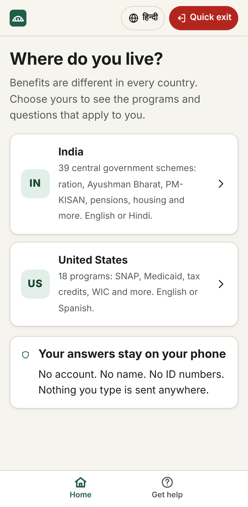
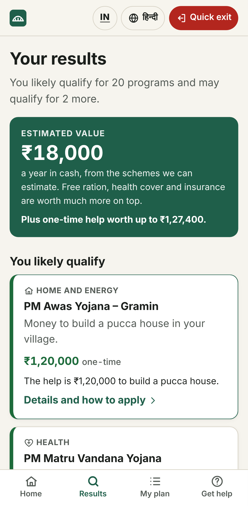
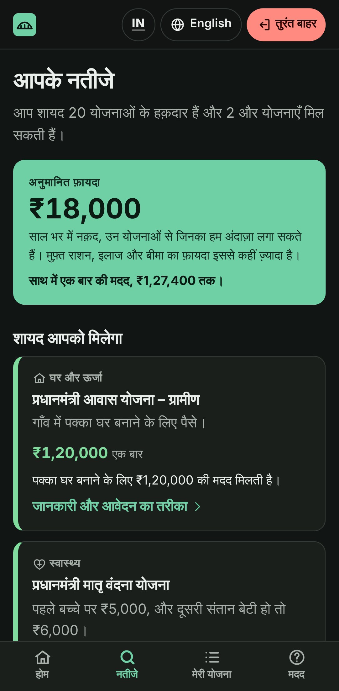

# BenefitBridge

**Find the government help your family may already qualify for. It's private, in plain language, and takes a few minutes.**

Every year, huge amounts of public support go unclaimed, because people don't know they qualify
or the process is too confusing. BenefitBridge first asks **which country you live in**, then
runs that country's own questionnaire. It shows the programs you likely qualify for, why, and
about how much they're worth. It also helps you follow through: papers to gather, steps to
apply, dates to remember, and printable plans.

| Country | Programs | Languages |
|---------|----------|-----------|
| 🇮🇳 India | **39 central schemes + 89 state and UT schemes**, official portal of all 36 states and UTs | English, हिन्दी (Hindi) |
| 🇺🇸 United States | **18 federal programs + state EITCs (33) and child tax credits (18)**, official benefits site of all 50 states and DC | English, Español |
| 🌍 19 more countries | **119 official programs** (directory: who it's for, papers, how to apply, official link) | English |

The home page shows **dated updates** (rule changes, deadlines, fraud alerts) for your country
and state. New ones are published in [`public/updates.json`](public/updates.json) and reach
every copy of the app the next time it's online.

<p>
  
  
  
  
</p>

## How it helps

- **Finds money and support people miss.** For example, a poor farming family in Bihar sees
  PM-KISAN, free ration, PM Awas, Ujjwala gas, 125 days of rural work, maternity benefits,
  scholarships and more: about **₹18,000 a year in cash plus ₹1.27 lakh of one-time help**.
  A family of 4 in Ohio sees about **$16,500 a year** in food and tax-credit help.
- **Asks criteria-wise questions.** India's questionnaire covers the details schemes actually
  depend on: state, village or town, age, women and children, 60+/70+, widows, disability
  level, SC/ST/OBC/minority, ration card type, BPL list, income, income tax, government job,
  PF/ESIC, farmland, work type, house type, LPG and bank account.
- **Explains why, plainly.** Every result gives its reasons ("Everyone aged 70 or more is
  covered under Ayushman Vay Vandana, whatever the income").
- **Gets it done.** For each scheme you get the papers to gather, how to apply, the official
  portal and national helpline number, and common questions.
- **Helps people keep their benefits.** "My plan" tracks status and dates, adds reminders to the
  phone's calendar, and prints a plan to take to the office.
- **Safe and private.** No account, no name and no ID numbers, and nothing leaves the phone.
  There's a quick-exit button, "delete everything", and country helplines (India: fraud 1930,
  women 181, child 1098, legal aid 15100, Elderline 14567, Tele-MANAS 14416, emergency 112).
- **Works for everyone.** Large tap targets, light and dark themes, screen-reader support
  (WCAG 2.1 AA is checked automatically on every screen), and it works offline.

## India: schemes checked

| Area | Schemes |
|------|---------|
| Food | Free ration (PMGKAY / NFSA, One Nation One Ration Card), Anganwadi / Poshan 2.0, PM POSHAN school meals |
| Health | Ayushman Bharat PM-JAY (incl. Vay Vandana for everyone 70+), Janani Suraksha Yojana, PM Matru Vandana Yojana |
| Home and energy | PMAY-Gramin, PMAY-Urban 2.0, PM Surya Ghar (rooftop solar), PM Ujjwala (LPG) |
| Jobs and business | Rural jobs guarantee (VB-G RAM G, which replaced MGNREGA on 1 July 2026), e-Shram, PM Vishwakarma, PM SVANidhi, Mudra, PMEGP, Skill India, PM Internship, first-job bonus (PM-VBRY) |
| Farmers | PM-KISAN, PM Kisan Maan-dhan, Kisan Credit Card, PM Fasal Bima |
| Pensions, insurance and support | Old-age, widow and disability pensions (NSAP), Atal Pension, PM-SYM, PMJJBY, PMSBY, Jan Dhan, Rashtriya Vayoshri, ADIP, UDID card |
| Women, children and students | Sukanya Samriddhi, self-help groups (DAY-NRLM / Lakhpati Didi), SC/ST/OBC/minority scholarships, Central Sector Scholarship, NMMSS |

**State and UT schemes.** After you choose your state, the results add its own flagship
schemes, checked against the same answers: for example Ladki Bahin (Maharashtra), Gruha Lakshmi
and Shakti (Karnataka), Kalaignar Magalir Urimai Thogai and Pudhumai Penn (Tamil Nadu), Subhadra
(Odisha), Lakshmir Bhandar and Kanyashree (West Bengal), Ladli Behna (Madhya Pradesh), Rythu
Bharosa and Mahalakshmi (Telangana), Kanya Sumangala (Uttar Pradesh) and Mahtari Vandan
(Chhattisgarh). Each comes with the papers to gather, the steps to apply and a link to its
official website. State schemes change often, so most are shown as "may qualify" with a note
to check the website. Every state and UT also gets a card with its official portal and its
myScheme page. See [`src/lib/india/stateSchemes.ts`](src/lib/india/stateSchemes.ts).

Central figures are those in force on 1 October 2026 (see
[`src/lib/india/rules2026.ts`](src/lib/india/rules2026.ts)).

## United States: programs checked

SNAP (with a monthly estimate), WIC, school meals, Medicaid (adults, pregnancy, kids/CHIP),
marketplace tax credits, Medicare Extra Help, EITC and Child Tax Credit (estimates), free tax
help, SSI (estimate), TANF, LIHEAP, Lifeline, Head Start, child care help and housing vouchers.
Figures use the 2026 poverty guidelines, SNAP limits for Oct 2026 – Sep 2027 and tax year 2026
credits (see [`src/lib/us/rulesets/2026.ts`](src/lib/us/rulesets/2026.ts)).

**State by state:** every state and DC gets a card with its official site to apply for SNAP,
Medicaid and cash help (for example BenefitsCal, Your Texas Benefits, myBenefits NY). The
results add your state's own earned income tax credit (as a share of the federal EITC where
the state uses one) and child tax credit, for tax year 2026 (see
[`src/lib/us/rulesets/stateCredits2026.ts`](src/lib/us/rulesets/stateCredits2026.ts)).

## Other countries

A directory of official government programs in the United Kingdom, Canada, Australia, New
Zealand, Ireland, Germany, France, Spain, Mexico, Brazil, the Philippines, Indonesia, Pakistan,
Bangladesh, Nepal, Sri Lanka, Kenya, South Africa and Singapore: who each program is for, what
it gives, the papers to gather, how to apply and the official link. It doesn't check
eligibility yet (see [`src/content/world/directory.ts`](src/content/world/directory.ts)).

## Try it

- **On a phone, no install:** download `benefitbridge.html` from the
  [latest release](../../releases/latest) and open it. It's a single file that works offline.
- **As an installable app:** host the `benefitbridge-web.zip` contents on any static host, or
  enable GitHub Pages (below), then use "Add to Home screen".

## Develop

```bash
npm install
npm run dev            # http://localhost:5173
npm test               # rules engines + content tests (Vitest)
npm run build          # dist/: installable PWA with offline service worker
npm run build:single   # dist-single/index.html: one self-contained file
npx playwright install chromium && npm run test:e2e   # end-to-end + accessibility tests
```

```
src/
  lib/core.ts            shared result types, ranking and totals
  lib/us/                US rules engine (one pure evaluate() per program) + golden tests
  lib/india/             India rules engine (one pure evaluate() per scheme) + golden tests
  content/ui/            shared screen text in English, Spanish and Hindi
  content/us/            US wording (en, es) and official links
  content/india/         India wording (en, hi), state scheme wording and official portals
  content/world/         directory of official programs in 19 more countries
  content/updates.ts     dated home-page updates shipped with the app (live ones: public/updates.json)
  countries/             country packs (rules + content + currency + languages) and questionnaires
  screens/               Country picker, Home, Results, Program, My plan, Help, Other countries
e2e/                     Playwright flows for both countries with axe accessibility checks
docs/PLAN.md             vision, roadmap, architecture, status by phase
```

**Adding a country:** write a rules engine under `src/lib/<country>/`, its wording under
`src/content/<country>/`, a questionnaire component, and register a pack in
`src/countries/index.ts`. The content tests check every language is complete.

**Publishing an update:** add an item to `public/updates.json` (the file explains the fields) and
push to `main`. No release is needed.

**Updating rules:** add a new dated rules file, point the engine at it, and update the golden
tests to the new official figures. Never edit a published rules file.

## Releases and hosting

- Pushing a tag like `v1.1.1`, or running `.github/workflows/release.yml` by hand with a version,
  tests the app, builds it, and publishes a GitHub Release with `benefitbridge.html` and
  `benefitbridge-web.zip`.
- `.github/workflows/pages.yml` deploys to GitHub Pages when run by hand. Enable Pages first
  (Settings → Pages → Source: GitHub Actions). Pages on a private repo needs a paid GitHub
  plan; otherwise make the repo public or use any static host.

## Disclaimer

BenefitBridge is not a government service. Results are estimates, and the office that runs each
program makes the final decision. Applying for government schemes is free — never pay an agent.
