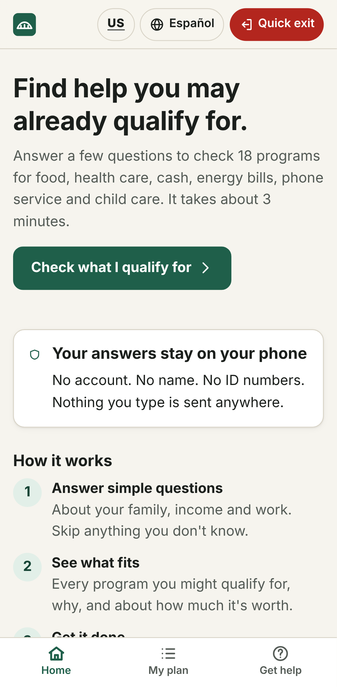
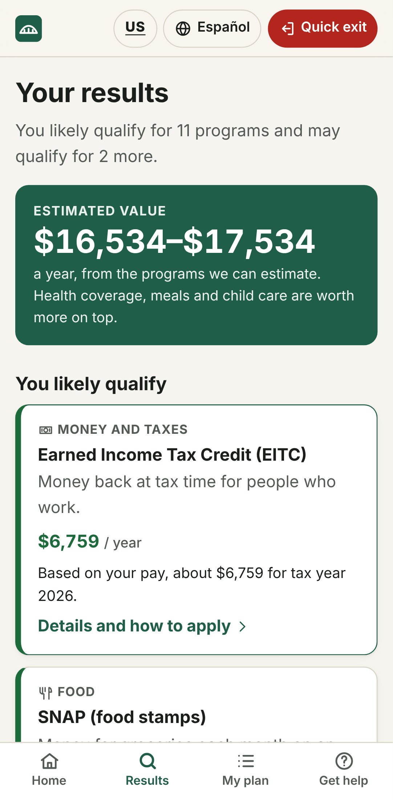
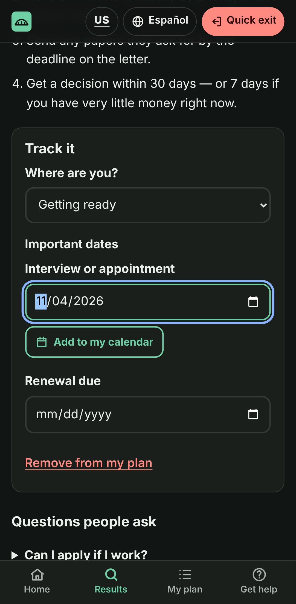
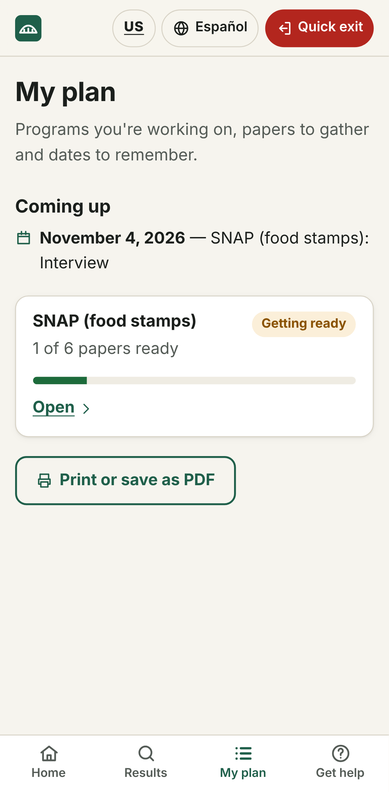

# BenefitBridge

**Find the help you may already qualify for. It's private, in plain English and Spanish, and takes about 3 minutes.**

Every year, tens of billions of dollars in food, health, cash, energy and child care help go
unclaimed, because people don't know they qualify or the process is too confusing.
BenefitBridge checks a household against **18 programs** and shows what they likely qualify
for and about how much it's worth. It also helps them follow through: papers to gather, steps
to apply, dates to remember, and printable plans.

<p>
  
  
  
  
</p>

## How it helps

- **Finds money people miss.** One screen shows every program a family may qualify for. For
  example, a family of 4 in Ohio earning $2,800 a month sees about **$16,500 a year** in food
  and tax-credit help, before counting health coverage, school meals and child care.
- **Explains why, plainly.** Every result gives its reasons ("Your income is under the $3,575
  a month limit for 4 people"), so people can trust it and fix wrong answers.
- **Gets it done.** For each program you get a checklist of papers, how to apply, the official
  site and phone number, and answers to common questions.
- **Helps people keep their benefits.** "My plan" tracks status and dates, adds interview and
  renewal reminders to your phone's calendar, and prints a one-page plan for appointments.
- **Safe and private.** No account, no name and no SSN, and nothing leaves the phone. There's a
  quick-exit button, a one-tap "delete everything", and links to 211, legal aid, immigration
  help and crisis lines.
- **Works for everyone.** Full Spanish, large tap targets, light and dark themes, screen-reader
  support (WCAG 2.1 AA is checked automatically on every screen), and it works offline once
  installed.

## Programs checked

| Category | Programs |
|----------|----------|
| Food | SNAP (with a monthly estimate), WIC, free or reduced-price school meals |
| Health | Medicaid for adults, Medicaid for pregnancy, Medicaid and CHIP for kids, marketplace tax credits, Medicare Extra Help |
| Money and taxes | EITC (estimate), Child Tax Credit (estimate), free tax filing help (VITA), SSI (estimate), TANF |
| Home and bills | LIHEAP energy help, Lifeline phone/internet discount, Housing Choice Vouchers |
| Kids and family | Head Start and Early Head Start, child care assistance |

The rules use figures in effect on **October 1, 2026**:
- 2026 HHS poverty guidelines
- SNAP limits and benefit amounts for Oct 2026 – Sep 2027
- Tax year 2026 EITC and Child Tax Credit
- 2026 SSI and Medicare Extra Help amounts
- Current Medicaid expansion status
- The 2025 law's SNAP and Medicaid work rules

Tests reproduce the published tables (for example the SNAP gross limits, the EITC maximums and
phase-out amounts, and the Lifeline and school-meal limits). Sources are listed in
[`src/lib/eligibility/rulesets/2026.ts`](src/lib/eligibility/rulesets/2026.ts).

## Try it

- **On a phone, no install:** download `benefitbridge.html` from the
  [latest release](../../releases/latest) and open it. It's a single file that works offline.
- **As an installable app:** host the `benefitbridge-web.zip` contents on any static host, or
  enable GitHub Pages (below), then use "Add to Home screen".

## Develop

```bash
npm install
npm run dev            # http://localhost:5173
npm test               # rules engine + content tests (Vitest)
npm run build          # dist/: installable PWA with offline service worker
npm run build:single   # dist-single/index.html: one self-contained file
npx playwright install chromium && npm run test:e2e   # end-to-end + accessibility tests
```

```
src/
  lib/eligibility/       rules engine: one pure evaluate() per program, no UI or language
    rulesets/2026.ts     every threshold, with sources (add a new file each year)
    calc.ts              SNAP budget, EITC, CTC and SSI math
    engine.test.ts       golden tests against official tables
  content/               English and Spanish text: programs, reasons, checklists, FAQs
  screens/               Home, Screener (5 steps), Results, Program, My plan, Help
e2e/                     Playwright flows with axe accessibility checks
docs/PLAN.md             vision, roadmap, architecture, status by phase
```

**Updating rules:** poverty guidelines change every January, SNAP figures every October and
tax figures every fall. Add a new ruleset file, point `currentRuleset` at it, and update the
golden tests to the new official tables.

## Releases and hosting

- Pushing a tag like `v1.0.1`, or running `.github/workflows/release.yml` by hand with a version, tests the app, builds
  it, and publishes a GitHub Release with `benefitbridge.html` and `benefitbridge-web.zip`.
- `.github/workflows/pages.yml` deploys to GitHub Pages when run by hand. Enable Pages first
  (Settings → Pages → Source: GitHub Actions). Pages on a private repo needs a paid GitHub
  plan; otherwise make the repo public or use any static host.

## Disclaimer

BenefitBridge is not a government service. Results are estimates, and the agency that runs each
program makes the final decision. For free help from a person, call or text **211**.
