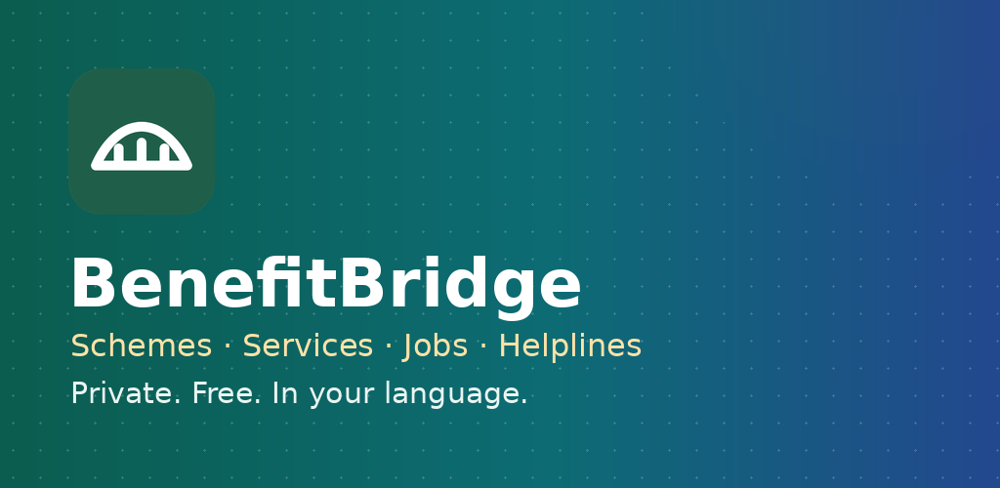
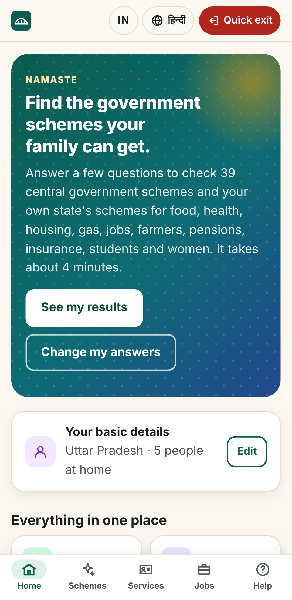
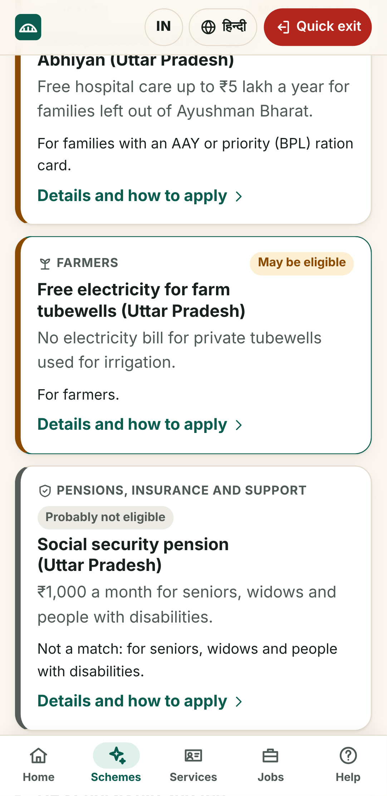
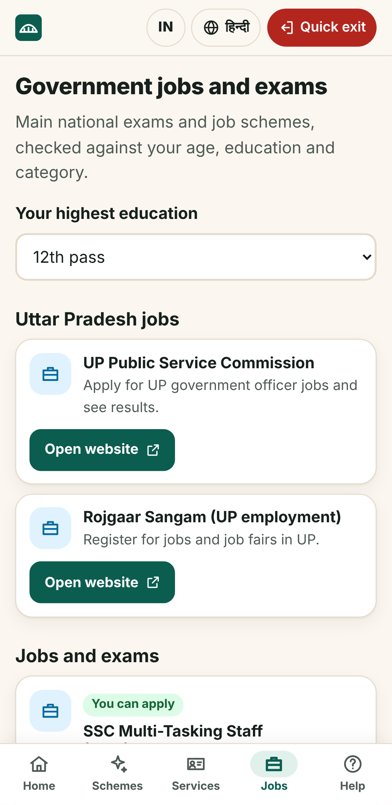
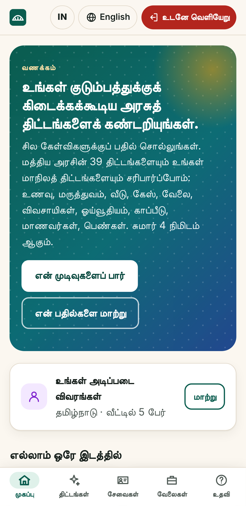

<p align="center">
  
</p>

<p align="center">
  <b>Every government scheme, service, job and helpline in one free app, in your language.</b><br>
  No account. No ads. No tracking. Works offline.
</p>

<p align="center">
  <a href="../../releases/latest"></a>
  <a href="../../actions/workflows/ci.yml"></a>
  <a href="LICENSE"></a>
  
  
</p>

<p align="center">
  
  
  
  
</p>

Billions in public support go unclaimed every year, because people don't know they qualify, can't
find the right website, or pay agents for what is free. **BenefitBridge** asks a few simple questions
once, then shows what your family can get and exactly where to apply, on the official website.

## ⬇️ Get it

| | |
|---|---|
| **Android** | Download `benefitbridge.apk` from the [latest release](../../releases/latest) and open it (allow "install unknown apps"). |
| **Any phone, no install** | Download `benefitbridge.html` from the [latest release](../../releases/latest) and open it. One file, works offline. |
| **Website** | Host `benefitbridge-web.zip` on any static host and "Add to Home screen". |

## ✨ What's inside

### 🇮🇳 India
- **Schemes for you** — 39 central schemes (free ration, Ayushman Bharat, PM-KISAN, PM Awas, Ujjwala,
  pensions, the 125-day rural jobs guarantee, scholarships…) and **240 state and UT schemes in all
  36 states and UTs**, shown in their own section for your state, with amounts, papers and steps.
- **Government services** — 300+ services with official links and helplines: Aadhaar, PAN, passport,
  voter ID, driving licence, certificates, land records, ration card, electricity, police, RTI,
  grievances, scholarships, PF, pensions — national and for every state.
- **Jobs and exams** — SSC, Railways, UPSC, banks, Agniveer, India Post, teaching and more, checked
  against your **age, education and category** (with SC/ST/OBC relaxation), plus your state's
  recruitment board and free training.
- **Helplines** — 112, 1930 (cyber fraud), 181 (women), 1098 (children), 14555 (Ayushman) and state
  numbers, one tap to call.
- **Your language** — English, हिन्दी, and after you choose your state: বাংলা, मराठी, தமிழ், తెలుగు,
  ಕನ್ನಡ, മലയാളം, ગુજરાતી, ਪੰਜਾਬੀ, ଓଡ଼ିଆ, অসমীয়া, اردو.

### 🇺🇸 United States
18 federal programs (SNAP, Medicaid, WIC, EITC, SSI…) with dollar estimates, state EITCs and child tax
credits, every state's official benefits site, federal services and helplines — in English and Spanish.

### 🌍 And more
- **My plan** — papers checklist, status tracking, interview and renewal dates.
- **Live updates** — new rules, deadlines and fraud alerts for your state ([`public/updates.json`](public/updates.json)).
- **19 more countries** — official programs in the UK, Canada, Australia, Germany, Mexico, Brazil,
  the Philippines, Pakistan, Bangladesh, Kenya, South Africa and more.

## 🔒 Private by design
Answers never leave the phone: no servers, no sign-in, no analytics. A quick-exit button and
"delete everything" are always one tap away. See the [privacy policy](docs/PRIVACY.md).

## 🧭 How it works
1. **Basic details once** — state, village or town, age, family. Every section uses them.
2. **Ask only what's needed** — schemes ask about income, cards and work; jobs ask about education.
3. **Official links only** — every link goes to a government website, never to agents.
4. **Rules, not guesses** — eligibility comes from dated rules files with sources, covered by tests.

## 🤝 Contribute
Found a wrong link or a missing scheme? [Open an issue](../../issues/new/choose) — no coding needed.
Translators and developers: see [CONTRIBUTING.md](CONTRIBUTING.md) and the [roadmap](docs/ROADMAP.md).

## 🛠️ Develop

```bash
npm install
npm run dev            # http://localhost:5173
npm test               # rules engines, content in every language, directory checks (Vitest)
npm run build          # dist/: installable PWA with offline service worker
npm run build:single   # dist-single/index.html: one self-contained file
npm run test:e2e       # Playwright flows + axe accessibility checks
```

```
src/
  lib/core.ts            shared result types, ranking and totals
  lib/india/             India rules: central schemes, state schemes (stateData/), jobs (jobs2026.ts)
  lib/us/                US rules: federal programs and state tax credits
  lib/jobs.ts            job eligibility (age, education, category relaxation)
  content/ui/            screen text in 14 languages
  content/india/         India wording (en, hi, 11 state languages), services, jobs
  content/us/            US wording (en, es), services, state benefit sites
  content/directory/     services and helplines model
  content/world/         official programs in 19 more countries
  screens/               Home hub, Schemes, Services, Jobs, Helplines, Program, Plan, Help
android/                 Capacitor Android app (built free on GitHub Actions)
fastlane/metadata/       Google Play listing text, graphics and screenshots
```

**Publishing updates:** add an item to `public/updates.json` and push to `main` — no release needed.
**Updating rules:** add a new dated rules file and update the golden tests; never edit a published one.

## 📦 Releases, Android and Google Play
- Running `.github/workflows/release.yml` with a version tests everything and publishes
  `benefitbridge.html`, `benefitbridge-web.zip` and `benefitbridge.apk` (and `benefitbridge.aab`
  for Google Play when a signing key is set).
- **Signing key (needed for Play and for updates that install over the old version):**
  ```bash
  keytool -genkeypair -v -keystore release.keystore -alias benefitbridge -keyalg RSA -keysize 4096 -validity 10000
  base64 -w0 release.keystore   # → repository secret ANDROID_KEYSTORE_BASE64
  ```
  Also add `ANDROID_KEYSTORE_PASSWORD`, `ANDROID_KEY_ALIAS` (`benefitbridge`) and `ANDROID_KEY_PASSWORD`.
  Never commit the keystore.
- The Play Store checklist, data-safety answers and listing are in [docs/PLAY_STORE.md](docs/PLAY_STORE.md).

## ⚠️ Disclaimer
BenefitBridge is an independent open-source project, **not a government app**, and is not
affiliated with any government. Results are estimates; the office that runs each scheme makes the
final decision. Applying for government schemes is free — never pay an agent.

Released under the [MIT License](LICENSE).
